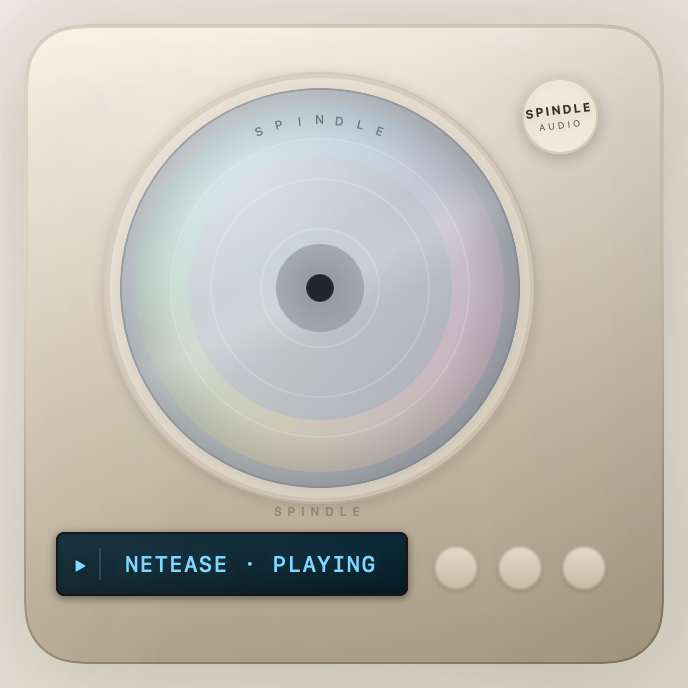
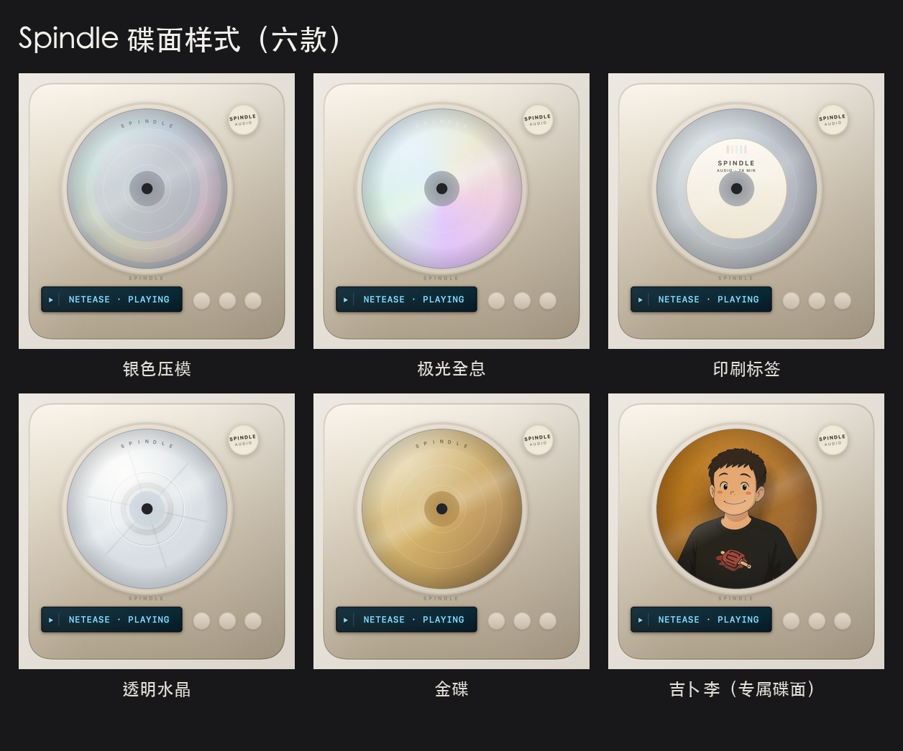
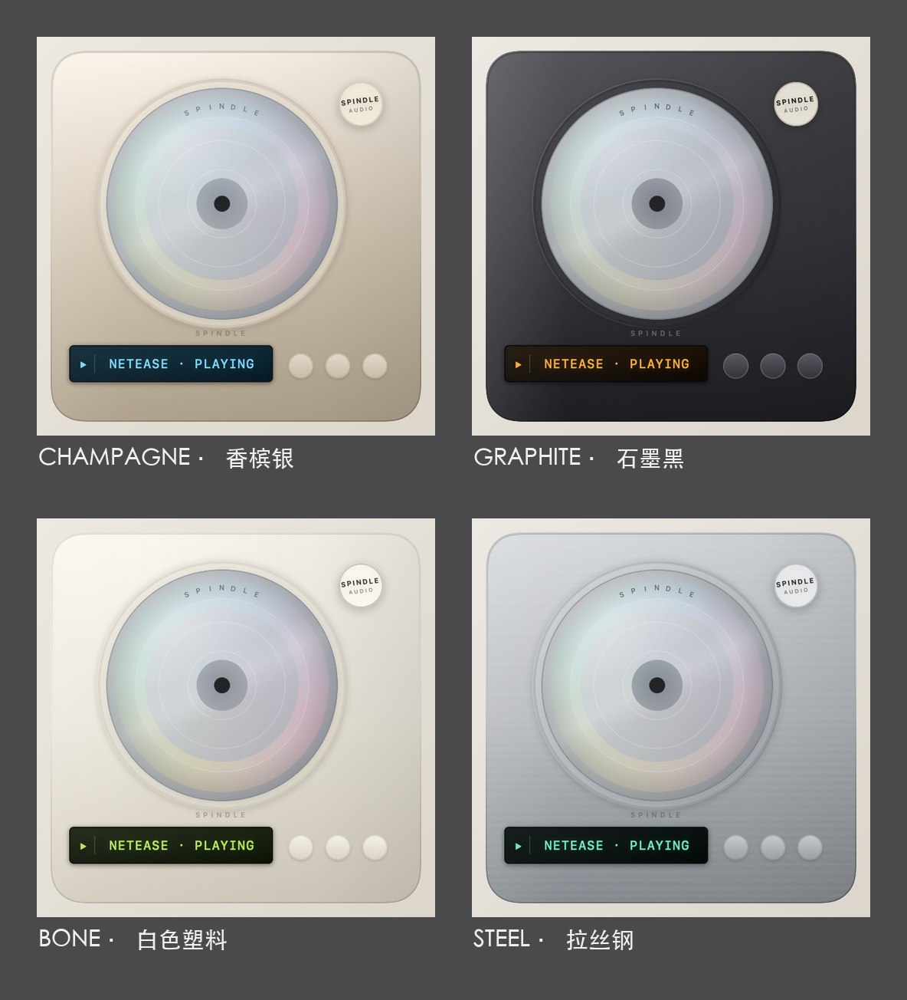

# Spindle

> 一台住在 Mac 桌面上的 CD 播放器摆件。它不播放音乐——只把“音乐正在响”翻译成碟片的转与停。



## 它做什么

- 音乐开始出声，碟片转动；暂停后惯性减速，停在当前角度；播放器退出后回到待机。
- Apple Music 工况下，LCD 显示曲名与艺人，专辑封面直接印在碟面上；其他音源只呈现转 / 停状态。
- 机身三键与菜单栏可控制 Apple Music：上一曲 / 播放暂停 / 下一曲。
- 纯菜单栏配件：不进 Dock、不抢焦点、不占用 ⌘-Tab，跟随所有 Space 悬浮在窗口之上。
- 可在菜单栏勾选开机自启（走系统登录项，默认关闭）。

## 播放器支持

| 音源 | 转 / 停 | 曲名 · 艺人 | 封面 | 播放控制 |
| --- | --- | --- | --- | --- |
| Apple Music | ✓ | ✓ | ✓ | ✓ |
| 网易云音乐 | ✓ | — | — | — |
| Spotify / YesPlayMusic / 浏览器等 | ✓ | — | — | — |

转 / 停判断基于 CoreAudio 的进程级音频活动；元数据读取与播放控制仅对 Apple Music 走本机 AppleScript。全程不联网、不登录、不读歌单与历史记录。

## 外观

四款机身皮肤、六款自有碟面；有封面时自动选用「专辑封面」碟面，手动切回自有碟面后不会被下一首封面顶掉。





## 环境要求

- macOS 14.0 或更新（Apple 芯片 / Intel）
- Swift 6 工具链（SwiftPM）

## 构建与运行

```bash
swift build -c release
./scripts/build-app.sh --install   # 装到 ~/Applications/Spindle.app
open ~/Applications/Spindle.app
```

打包通用二进制（Intel + Apple 芯片）zip：

```bash
./scripts/build-app.sh --package
```

离线渲染评审图（不依赖屏幕截图）：

```bash
.build/release/Spindle --render out.png
.build/release/Spindle --render-discs docs/design/renders/discs
.build/release/Spindle --render-skins  docs/design/renders/skins
```

## 不做什么

- 不做播放器：不选歌、不调音量、不写回第三方 App 的状态。
- 不联网、不登录、不做账号与云同步。
- 不做多播放器同时出声的复杂仲裁，只回答“现在有没有在出声”。

## 项目结构

| 路径 | 内容 |
| --- | --- |
| `Sources/Spindle/` | 应用源码（AppKit 窗口 + SwiftUI 绘制） |
| `docs/design/visual-spec.md` | 视觉规格与设计 token |
| `docs/decisions/` | 长期技术决策（ADR） |
| `docs/PROJECT-CONTEXT.md` | 项目背景、检测能力矩阵与非目标 |
| `scripts/build-app.sh` | 组装 `.app`、安装与打包 |

## 技术栈

Swift 6 · SwiftPM · AppKit · SwiftUI；检测链路 CoreAudio，元数据与控制通道 AppleScript。

> 个人早期项目，尚未指定开源协议；能力口径以代码与 `docs/` 为准。
